### Aabhas Kr Jha

  <a href="https://aabhaskrjha.com">
    
    Website
  </a>
  &nbsp; · &nbsp;
  <a href="https://ramslabs.com">
    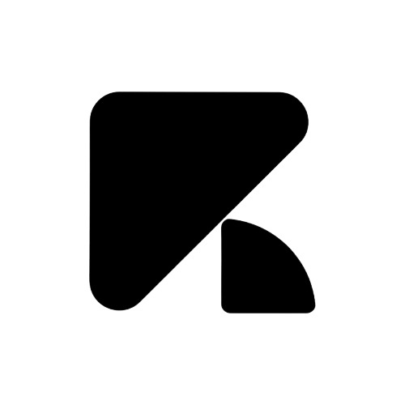
    Rams Labs
  </a>
  &nbsp; · &nbsp;
  <a href="https://www.linkedin.com/in/aabhaskrjha/">LinkedIn</a>
  &nbsp; · &nbsp;
  <a href="https://cal.com/aabhaskrjha">Book a call</a>

I'm a software engineer and technical architect who enjoys building systems from the ground up. Greenfield is where I think most clearly.

<strong>Track record</strong>

- B2B procurement automation : ₹3Cr+ GMV in a single quarter
- Railways logistics platform : 700+ trains, 200+ kitchens
- LMS serving 2,000+ students
- 60–80% operational workload reduction across teams

<strong>Focus</strong>

Manufacturing, Logistics, Supply Chain, Procurement, EdTech, Healthcare, Cybersecurity, Finance.

#### Stack

  

  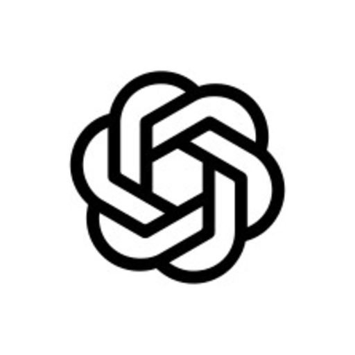
  &nbsp;
  
  &nbsp;
  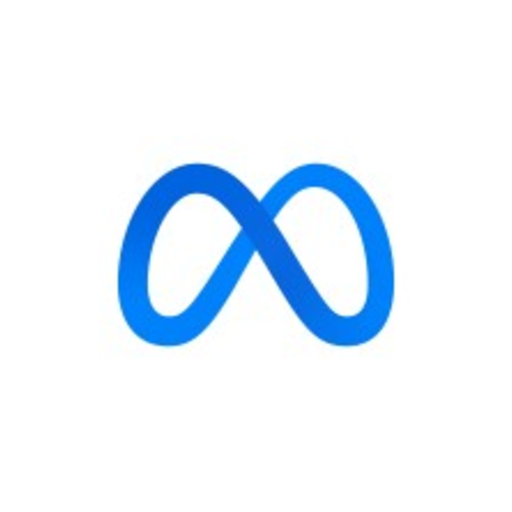
  &nbsp;
  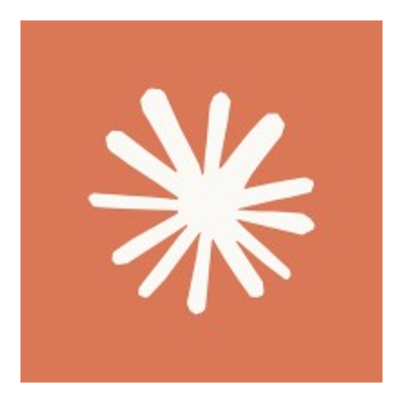
  &nbsp;
  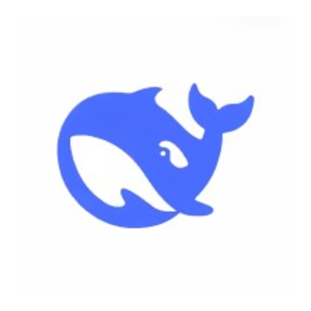
  &nbsp;
  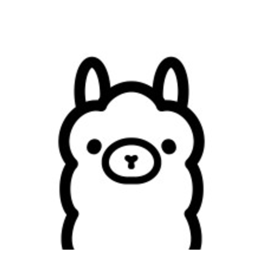
  &nbsp;
  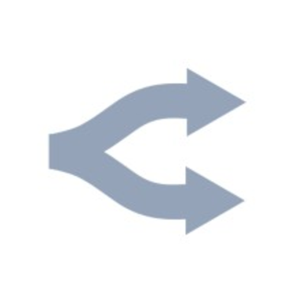
  &nbsp;
  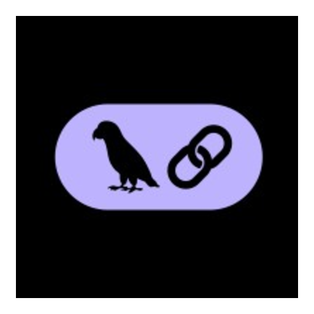
  &nbsp;
  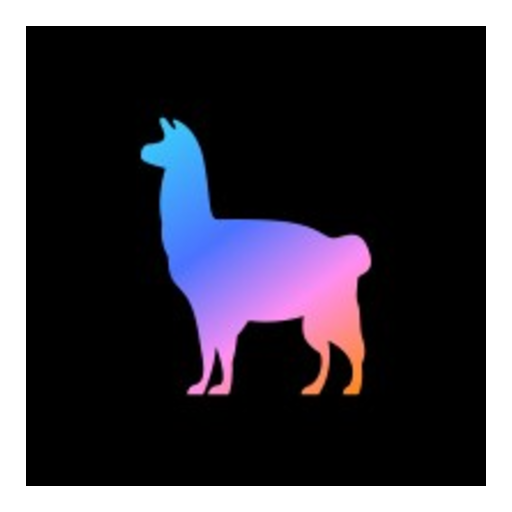
  &nbsp;
  
  &nbsp;
  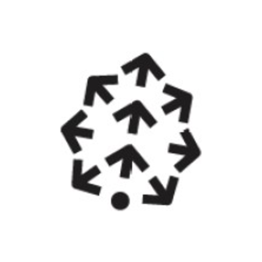
  &nbsp;
  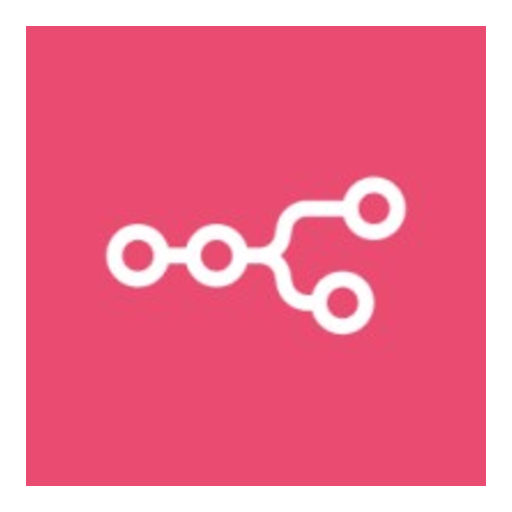

